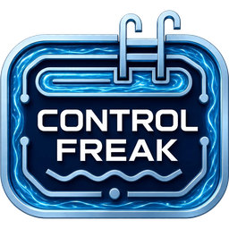
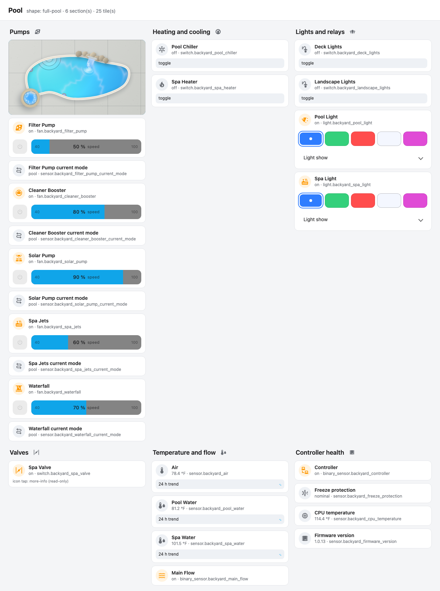
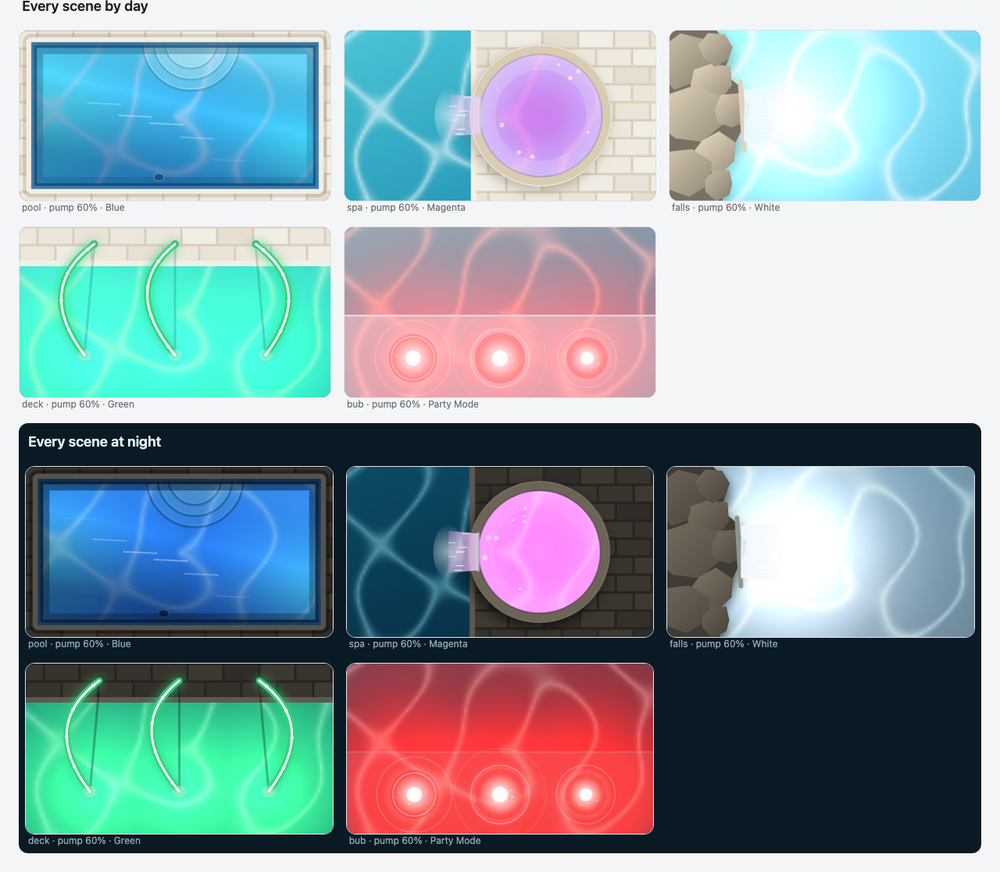
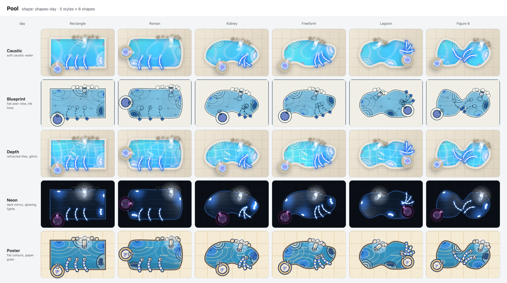

# Control Freak Automated Pool System for Home Assistant



**The official Home Assistant integration from Control Freak**, the maker of the Control
Freak pool automation controller.

A local-only Home Assistant integration for the [Control Freak](https://controlfreakpool.com)
pool controller. It reads the
controller's REST API for the equipment you've configured and listens to its MQTT broker over
WebSockets for live values. No cloud, and your own MQTT setup is unaffected.

- **Equipment-driven entities:** pumps (fan with speed, current mode), heaters and chillers,
  color lights with effects, relays, valves (read-only), temperatures, flow and controller
  health, all under the names you gave them in the Control Freak app. Add or remove
  equipment in the Control Freak app and Home Assistant follows without a restart. The
  fan percentage is the pump's own speed (40–100 on a typical variable-speed pump), and
  every entity carries one of Control Freak's own `cf:` icons.
- **A dashboard that builds itself:** `strategy: { type: custom:controlfreak }` creates a
  dashboard with a section per equipment type you actually have. A settings dialog in the
  dashboard editor picks the pictures, style, pool shape, deck finish, picture height and
  tile controls; single sections drop into an existing dashboard.
- **Pool controls on the tiles:** a speed slider over the pump's real range with an Off
  button, a bar of colour swatches per light, and a light show menu with a chip of the
  colours each Pentair show performs (SAm, Party, Romance, Caribbean, American, California
  Sunset, Royal). `controls: core` keeps Home Assistant's own tile features.
- **Animated pictures:** the pool from above with its spa, waterfall, deck jets and bubblers,
  in the shape of yours (twelve outlines from rectangle to lagoon) on a concrete, paver,
  travertine, wood or stone deck, in one of five styles, each picture resizable, the water
  moving with pump speed and tinted by the light's effect, dark at night.







## Install

**Home Assistant 2026.11 and later (Marketplace).** Marketplace is HACS built into Home
Assistant, under **Settings**. Until the integration is in the catalog, add
`https://github.com/Jimmyneox/ha-controlfreak` as a custom repository of type
**Integration** (Marketplace asks you to connect a GitHub account for custom repositories),
then install **Control Freak Automated Pool System**.

**Earlier versions (HACS).** In HACS, open the three dots menu > **Custom repositories**, add
the same URL with type **Integration**, install, and restart Home Assistant.

Then go to **Settings** > **Devices & services** > **Add integration** and select **Control
Freak Automated Pool System**.

Manual install: copy `custom_components/controlfreak` into your `config/custom_components/`.

## Documentation

Setup, every entity, the dashboard options, data updates, known limitations and
troubleshooting: **[docs/controlfreak.md](docs/controlfreak.md)**.

## Development

```sh
uv venv -p 3.14 && uv pip install -r requirements_test.txt
uv run --no-project pytest -q
uv run --no-project ruff check .
node --test tests/frontend/*.test.mjs
```

The Python tests run against real, scrubbed responses from a controller
(`tests/fixtures/`). The dashboard tests run the strategy against hass stubs that
`tests/test_frontend.py` generates from the integration's own entities
(`UPDATE_DASHBOARD_FIXTURES=1` regenerates them). To see the render check, serve the
repository root (`python3 -m http.server`) and open
`tests/frontend/harness.html?shape=full-pool` (or `?shape=pictures` for every animated
scene, shape and the editors; `?shape=shapes-day`, `decks-day` and `styles-day` and their
`-night` twins for the contact sheets).

## License

MIT

## How Control Freak works

Sensors measure, the controller decides and your equipment acts. This integration talks to
the controller on your LAN. For the whole system, see
[controlfreakpool.com/how-it-works](https://controlfreakpool.com/how-it-works).
