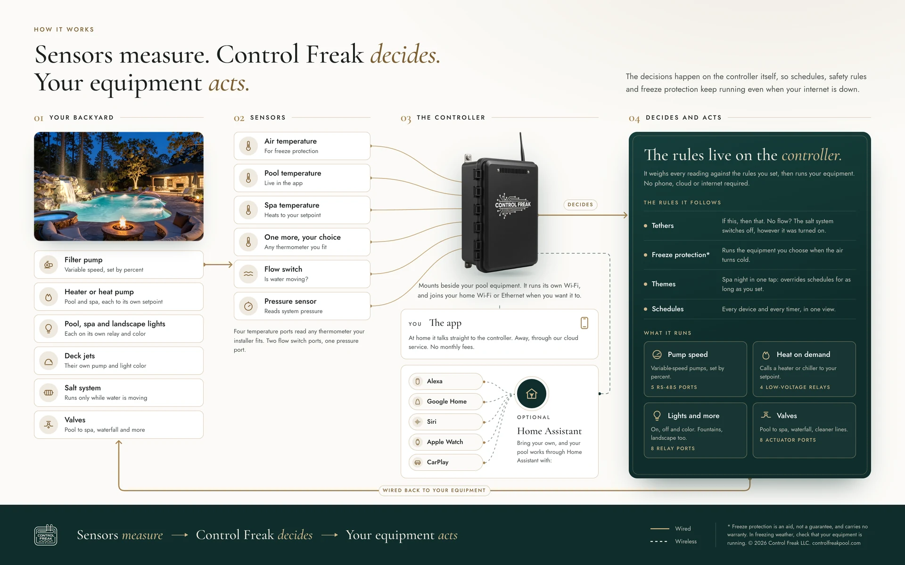
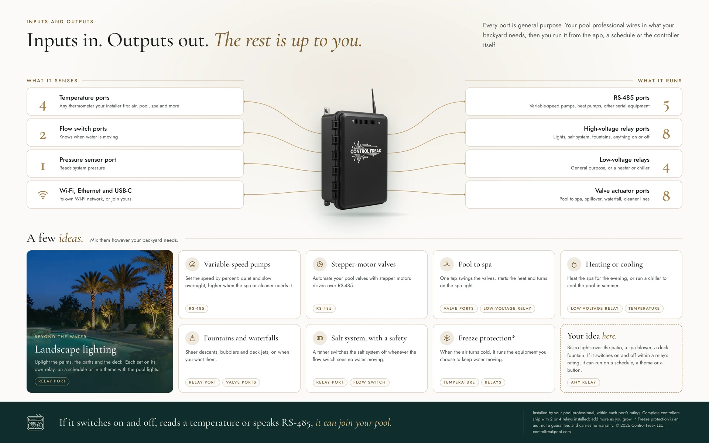

# Control Freak Automated Pool System for Home Assistant


**The official Home Assistant integration from Control Freak**, the maker of the Control
Freak pool automation controller.

A local-only Home Assistant integration for the [Control Freak](https://controlfreakpool.com)
pool controller. It reads the
controller's REST API for the equipment you've configured and listens to its MQTT broker over
WebSockets for live values. No cloud, and your own MQTT setup is unaffected.

- **Equipment-driven entities:** pumps (fan with speed, mode select), heaters and chillers,
  color lights with effects, relays, valves (read-only), temperatures, flow and controller
  health, all under the names you gave them in the Control Freak app. Add or remove
  equipment in the Control Freak app and Home Assistant follows without a restart.
- **A dashboard that builds itself:** `strategy: { type: custom:controlfreak }` creates a
  dashboard with a section per equipment type you actually have, using only built-in cards.
  Single sections drop into an existing dashboard.


## Install

**Home Assistant 2026.11 and later (Marketplace).** Marketplace is HACS built into Home
Assistant, under **Settings**. Until the integration is in the catalog, add
`https://github.com/Jimmyneox/ha-controlfreak` as a custom repository of type
**Integration** (Marketplace asks you to connect a GitHub account for custom repositories),
then install **Control Freak Automated Pool System**.

**Earlier versions (HACS).** In HACS, open the three dots menu > **Custom repositories**, add
the same URL with type **Integration**, install, and restart Home Assistant.

Then go to **Settings** > **Devices & services** > **Add integration** and select **Control
Freak Automated Pool System**.

Manual install: copy `custom_components/controlfreak` into your `config/custom_components/`.

## Documentation

Setup, every entity, the dashboard options, data updates, known limitations and
troubleshooting: **[docs/controlfreak.md](docs/controlfreak.md)**.

## Development

```sh
uv venv -p 3.14 && uv pip install -r requirements_test.txt
uv run --no-project pytest -q
uv run --no-project ruff check .
node --test tests/frontend/*.test.mjs
```

The Python tests run against real, scrubbed responses from a controller
(`tests/fixtures/`). The dashboard tests run the strategy against hass stubs that
`tests/test_frontend.py` generates from the integration's own entities
(`UPDATE_DASHBOARD_FIXTURES=1` regenerates them). To see the render check, serve the
repository root (`python3 -m http.server`) and open
`tests/frontend/harness.html?shape=full-pool`.

## License

MIT

## How Control Freak works

Sensors measure, the controller decides and your equipment acts. This integration
talks to the controller on your LAN; the pages below show the whole system.
[Download the 2-page PDF](https://controlfreakpool.com/assets/diagrams/Control-Freak-How-It-Works.pdf)
or see it on [controlfreakpool.com/how-it-works](https://controlfreakpool.com/how-it-works).

[](https://controlfreakpool.com/assets/diagrams/how-it-works-3840.webp)

[](https://controlfreakpool.com/assets/diagrams/inputs-outputs-3840.webp)

\* Freeze protection is an aid and carries no warranty. Apple Watch, Siri, Alexa,
Google Home and CarPlay work through Home Assistant.
