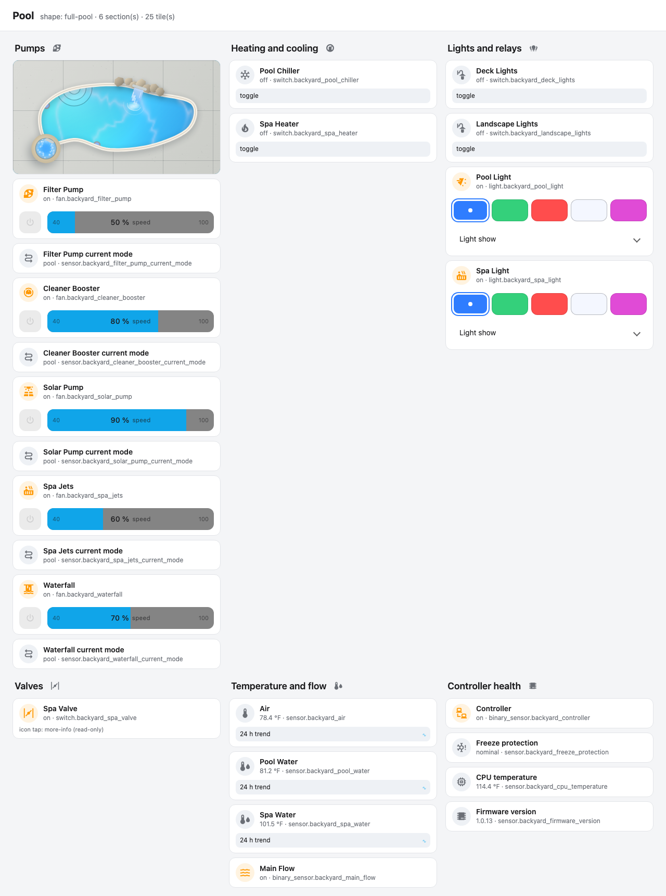
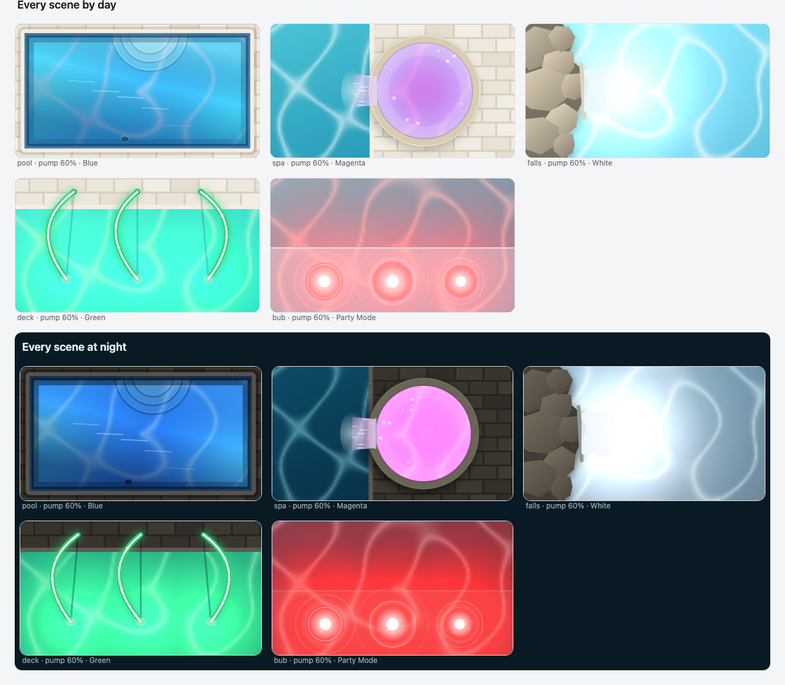
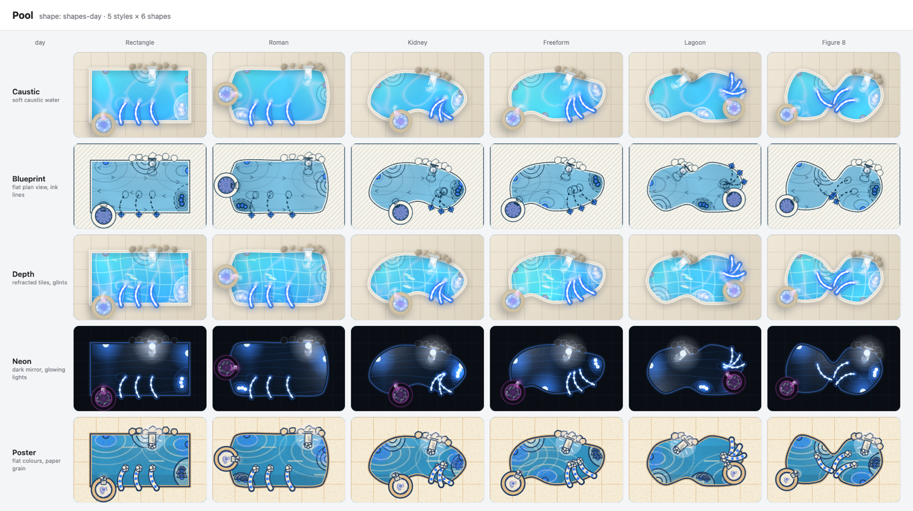
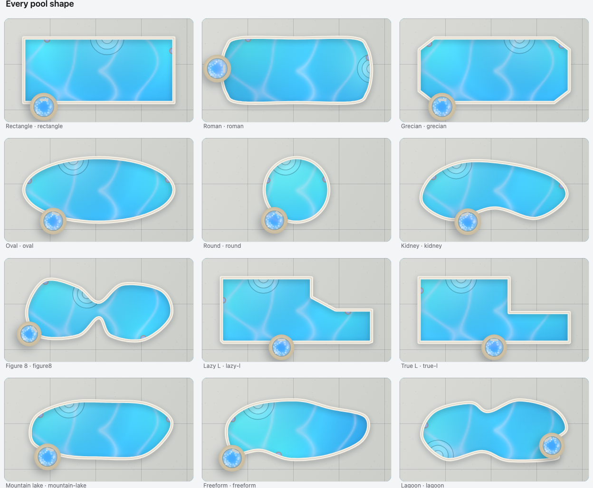
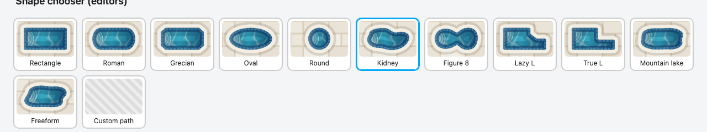
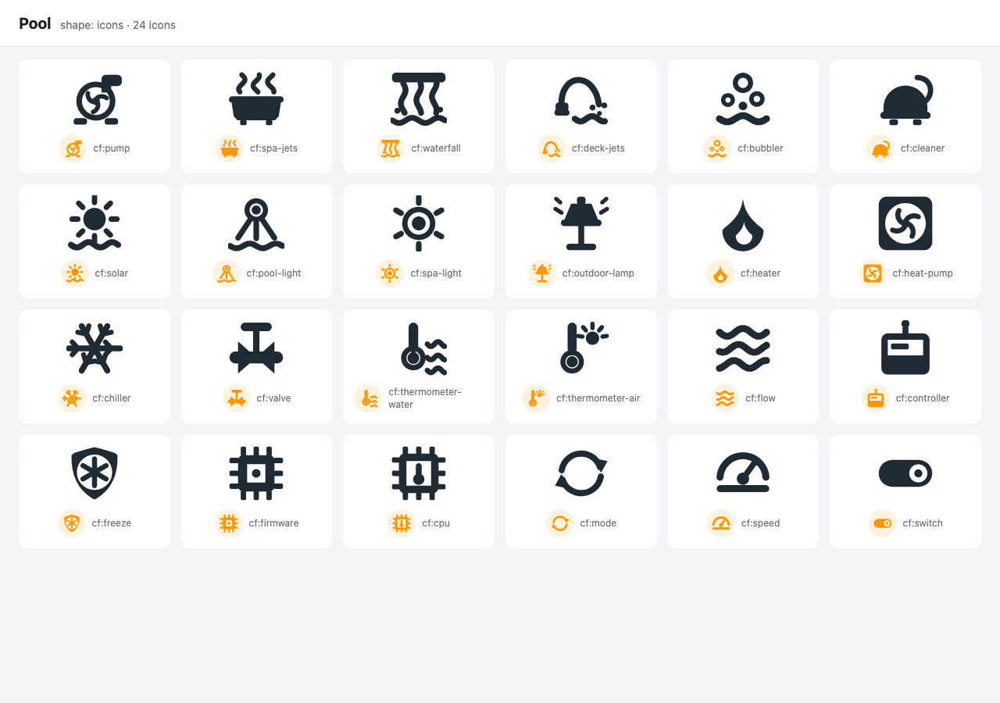
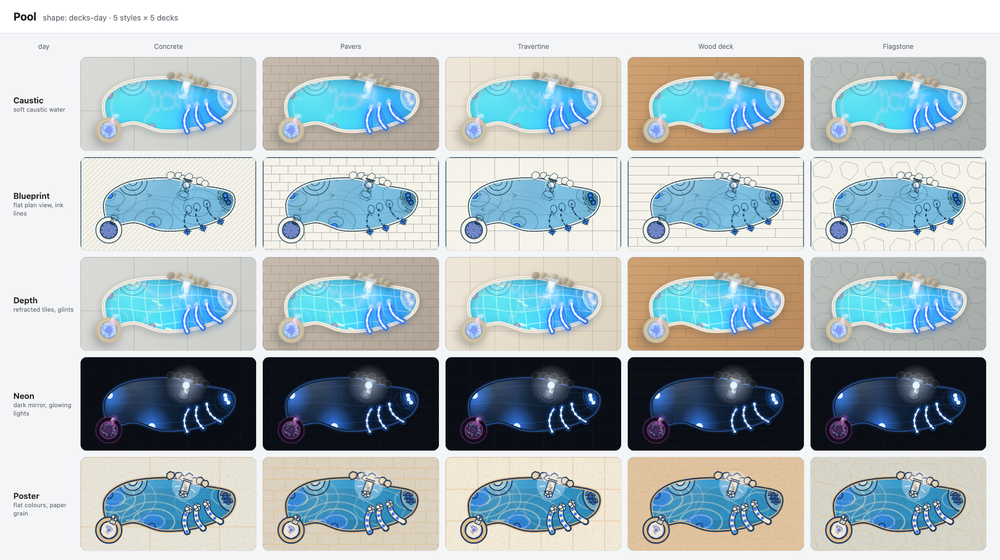
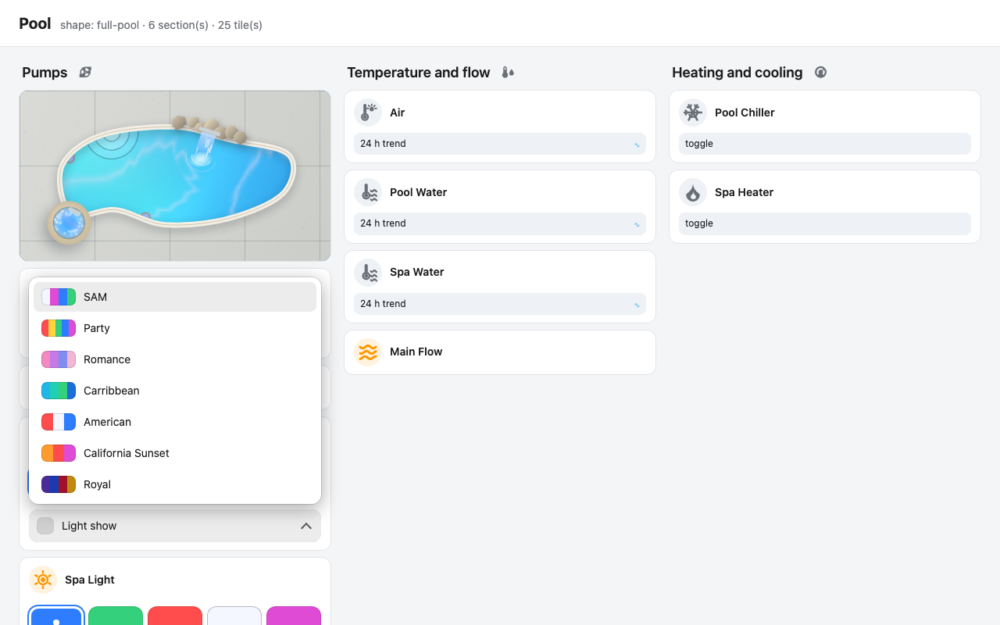

The **Control Freak Automated Pool System** integration connects Home Assistant to a
Control Freak automation controller on your local network. You can run your pumps, heaters,
chillers, lights and other relays from Home Assistant, and see water and air temperatures,
flow and the controller's health.

Use it to put the pool on the same dashboards and automations as the rest of your home. For
example, you can start the spa jets from a voice assistant, switch the pool light to a color
show at sunset, or get a notification when freeze protection activates.

The Control Freak controller is designed and built by Control Freak, and this is Control
Freak's official integration for it. For product information,
see the maker's website, [controlfreakpool.com](https://controlfreakpool.com).

## Supported devices

The integration works with the [Control Freak automation controller](https://controlfreakpool.com). Its outputs are
general-purpose: you decide in the Control Freak app what is connected to each port, and the
integration creates entities from that configuration, using the names you gave your equipment.
Nothing is tied to a port number.

The controller board has:

- **5 RS-485 ports** for variable-speed pumps and other serial equipment. Each configured pump
  becomes a pump entity with speed control.
- **4 low-voltage relays** (dry contact). Each one is either a general relay or, optionally, a
  heater or chiller with the controller's built-in control logic. A common setup uses one for a
  heater and one for a chiller, and the others for anything else, such as deck or landscape
  lighting.
- **8 high-voltage relays** for single-speed pumps, lights, a salt cell or other loads. Relays
  with a color light type (for example Pentair, Hayward or Jandy) become lights with effects.
- **8 valve actuator ports**. Valves are shown read-only for now, see
  [Known limitations](#known-limitations).
- **4 temperature sensor ports** (10K thermistors) for water, air or solar temperature.
- **2 flow switch ports**.
- **1 pressure sensor port**. The controller publishes the reading, but the integration
  doesn't create an entity for it yet.

Schedules, themes, tethers and freeze protection run on the controller itself and keep
working whatever Home Assistant does.

The integration has been tested against controller API version 1.0.13 with a Fairland
variable-speed pump, Pentair color lights and two thermistors. Heater and chiller relays,
valves and more than one pump follow the same API, but haven't been confirmed on a live
controller yet.

## Prerequisites

1. Set up your equipment in the Control Freak app, so that the controller knows which pump,
   light or sensor is on each port.
2. Find the controller's IP address or host name, for example in your router's list of
   connected devices. A fixed IP address (a DHCP reservation) is recommended.
3. Make sure Home Assistant can reach the controller on these ports:
   - **8000**: the controller's REST API.
   - **8080**: the controller's MQTT broker over WebSockets. The controller ships with
     anonymous access on path `/`, which is what the integration uses.

The integration doesn't use the Home Assistant MQTT integration, so an existing MQTT broker
is not affected.

## Configuration

To add the **Control Freak Automated Pool System** hub to your Home Assistant instance, use
this My button:

[](https://my.home-assistant.io/redirect/config_flow_start/?domain=controlfreak)

If the integration isn't installed yet, install it first: from **Marketplace** under **Settings** (Home Assistant 2026.11 and
later), or from HACS on earlier versions. If the My button
doesn't work, set it up manually:

1. Go to **Settings** > **Devices & services**.
2. In the bottom right corner, select **Add integration**.
3. From the list, select **Control Freak Automated Pool System**.
4. Follow the instructions on screen.

| Parameter | Description |
|---|---|
| **Host** | The IP address or host name of the controller. For example, `controlfreak.local`. |
| **REST API port** | The port of the controller's REST API. The default is `8000`. Change it only if you changed it on the controller. |
| **MQTT WebSocket port** | The port of the controller's MQTT broker over WebSockets. The default is `8080`. |

Before it creates the entry, the integration checks that the REST API reports a healthy
Control Freak controller and that the MQTT broker accepts a connection.

## Configuration options

To change the options, go to **Settings** > **Devices & services** > **Control Freak
Automated Pool System** and select **Configure**.

| Option | Description |
|---|---|
| **Equipment discovery interval (seconds)** | How often the integration reads the controller's equipment list to add or remove entities. The default is 60 seconds, the range is 10 to 3600. Live values don't depend on it; they're pushed over MQTT. |

## Supported functionality

The integration creates one device, the controller. Each piece of equipment configured on
the controller adds the entities below.

### Pumps

- **Pump** (fan)
  - **Description**: Turns the pump on or off and sets its speed as a percentage. 1% is the
    pump's configured minimum speed and 100% is its maximum.
- **Speed** (sensor)
  - **Description**: The current speed as a percentage.
- **Current mode** (sensor)
  - **Description**: The mode the pump reports.

### Lights and relays

- **Light** (light)
  - **Description**: A relay with a color light on it. Turns the light on or off and sets
    the color or show through the light's effect list.
  - **Remarks**: The effects come from the light type configured on the controller (for
    example Pentair or Hayward).
- **Relay** (switch)
  - **Description**: Any other high-voltage or low-voltage relay, such as landscape
    lighting or a salt cell. It keeps the name you gave it in the Control Freak app.

### Heating and cooling

- **Heater** or **Chiller** (switch)
  - **Description**: A low-voltage relay that is configured in the Control Freak app as a
    heater (gas heater or heat pump) or a chiller. Turns it on or off; the controller's own
    control logic does the rest.
  - **Remarks**: The role comes from the relay's configuration, not from the port it's on.
    Set points stay in the Control Freak app.

### Valves

- **Valve** (switch)
  - **Description**: Shows whether the valve is active.
  - **Remarks**: Read-only. Turning it on or off raises an error.

### Temperature and flow

- **Temperature** (sensor)
  - **Description**: The thermistor's temperature in °F. Home Assistant converts it to your
    unit system.
  - **Remarks**: Unavailable when the thermistor is inactive, or after 180 seconds without
    an update.
- **Flow** (binary sensor)
  - **Description**: On when the flow sensor reports water flow.

### Controller

- **Controller** (binary sensor, connectivity)
  - **Description**: On while the controller publishes its status. Off after 300 seconds
    without one.
- **Freeze protection** (sensor)
  - **Description**: The state of the controller's freeze protection.
- **CPU temperature** (sensor, diagnostic)
  - **Description**: The temperature of the controller's processor.
- **Firmware version** (sensor, diagnostic)
  - **Description**: The controller's API version.

## Dashboard

The integration includes a dashboard strategy. It builds a dashboard from the equipment that
your controller actually has: a section for pumps, heating and cooling, lights and relays,
valves, temperature and flow, and controller health. Sections without equipment are left out. Equipment of a
type the strategy doesn't know yet appears in an **Other equipment** section. The dashboard
uses cards that come with Home Assistant (heading and tile cards with tile features) plus the
integration's own picture card for the animated pictures, so you don't need to install
anything else.

The strategy and the picture card are served by the integration and loaded automatically. You
don't need to add a dashboard resource. Tiles show each entity's own name, without the
controller's device name in front.



### Animated pictures

At the top of the **Pumps** section, the dashboard shows an animated picture of your pool from
above: the water inside the pool's outline, the deck and coping around it, and the parts the
controller runs in their places: an attached spa, the steps, a tanning ledge with bubblers, a
waterfall over rocks, deck jets and the lights. Each part follows its own pump and light. The
water moves with the pump's speed and stands still when the pump is off. If a light belongs to the
same feature, the water takes the colour of the light's current effect, and a colour show
cycles through its hues. At night (the Home Assistant dark theme, or your device's dark
mode) the water darkens and the light stands out. When the filter pump reports the
**spillover** mode, the spa picture pours over its edge into the pool. A tap on a picture
makes a splash.



Pick the outline that looks most like your pool with `picture_shape` (see *Pool shape* below).



The strategy finds each part from the pump's name, as you set it in the Control Freak app:

| Name contains | Part | Light with a matching name |
|---|---|---|
| filter, circulation, main, pool | Pool | for example *Pool Light* |
| jet, spa, hot tub | Spa | for example *Spa Light* |
| waterfall, falls, sheer, cascade, fountain, scupper, curtain | Waterfall | for example *Waterfall Light* |
| deck, laminar | Deck jets | |
| bubbler, bubbles | Bubblers | for example *Bubbler Light* |

A cleaner, booster or solar pump gets no part, and neither does a pump whose name matches
nothing: the strategy never guesses. A part the controller doesn't run isn't drawn. Pictures
are drawn in the browser only; nothing is sent to the controller.

To leave the picture out, set `pictures: false` under `strategy` (see below). To get one
picture per water feature instead of the overview, set `pictures: features`. If your
browser or operating system asks for reduced motion, each picture is a still image. Pictures
pause while they are off screen or the tab is hidden.

#### Pool shape

The pool is drawn in the outline of your pool. To pick the one that matches, open the
dashboard, choose the pencil (**Edit dashboard**), and the strategy's settings dialog shows
every shape as a small picture: tap one, pick a style, a deck finish and the picture height,
and **Save**.
The same dialog switches the pictures off or to one per feature, and sets the dashboard
title. In YAML the choice is `picture_shape`, with the pictures' height in `picture_rows`:

```yaml
strategy:
  type: custom:controlfreak
  picture_shape: kidney   # see the table
  picture_rows: 6         # optional, picture height in grid rows (2..12, default 4)
```

| `picture_shape` | Outline |
|---|---|
| `rectangle` | Straight sides, softened corners. The default. |
| `roman` | A rectangle with half-round ends. |
| `grecian` | A rectangle with the corners cut at 45°. |
| `oval` | An ellipse that fills the picture. |
| `round` | A circle, centred. |
| `kidney` | The classic bean. |
| `figure8` | Two round lobes with a waist. |
| `lazy-l` | An L whose deep leg meets the wide shallow end at an angle. |
| `true-l` | An L with a square inner corner. |
| `mountain-lake` | An oblong with gently curved sides. |
| `freeform` | A lagoon with no straight edge. |
| `lagoon` | A wider, rounder freeform. |



Every pool is drawn from above on a paver deck with its coping: Roman entry steps at the
shallow end, the water deepening towards the main drain, and a band of waterline tile. The
spa, waterfall, deck jets and bubblers sit against the outline in their own places.

#### Picture size

Pictures are full width and four rows high by default. In a **sections** view you can resize
each one by hand: open the dashboard editor, choose the picture card, then **Layout**, and
drag it taller or shorter (two to twelve rows) or narrower. On a dashboard the strategy
generates, use **Take control** first, or set `picture_rows` as above, which sets every
picture's starting height. A card you add by hand (below) also takes `rows`, a fixed
`height`, or an `aspect_ratio` for views without a grid.



You can also add a picture by hand to any dashboard, or pick **Control Freak picture** in the
card picker and fill in the editor. The overview:

```yaml
type: custom:controlfreak-picture
scene: overview
shape: kidney                      # see the table above
style: depth                       # optional, see Picture styles
pumps:
  pool: fan.filter_pump            # the water moves with this pump
  spa: fan.spa_jets                # each part follows its own pump
  falls: fan.waterfall
lights:
  pool: light.pool_light           # and its own light
  spa: light.spa_light
spillover: sensor.filter_pump_current_mode  # optional
show: [steps, ledge]               # optional: parts to draw without a pump or light
rows: 5                            # optional, starting height in a sections view (2..12)
```

A part is drawn when it has a pump or a light, or is listed under `show` (`spa`, `falls`,
`deck`, `bub`, `steps`, `ledge`). Or one water feature on its own:

```yaml
type: custom:controlfreak-picture
scene: pool         # pool, spa, falls, deck or bub
shape: lazy-l       # pool only, see the table above
pump: fan.filter_pump   # optional, the water moves with this pump's speed
light: light.pool_light  # optional, the water takes this light's effect colour
spillover: sensor.filter_pump_current_mode  # optional (spa only)
rows: 5             # optional, starting height in a sections view (2..12)
height: 260px       # optional, a fixed height instead (outside a sections view)
aspect_ratio: "16:9"  # optional, height from the width instead
```

Only `scene` is required. Without a pump the water is still; without a light it keeps its
natural colour. Add `style:` to pick one of the picture styles below. The card is full width
in a sections view; its height follows the card's rows and is at least 200 pixels unless
`height` or `aspect_ratio` says otherwise. To tune the water colours, set the CSS variables
`--controlfreak-water-a`, `--controlfreak-water-b` and `--controlfreak-water-hi` in your theme
(hex colours).

### Picture styles

The pictures come in five styles. Every style shows the same five scenes, follows the pump's
speed and the light's effect colour, and darkens at night.

| Style | Look |
|---|---|
| `caustic` | Soft caustic water, as in the Control Freak app. The default. |
| `blueprint` | A flat plan view drawn in ink lines, with slow drifting ripple rings. Reads well on small cards. |
| `depth` | Layered water: a tiled floor seen through the ripples, sun glints by day, a shadowed edge. The richest of the five. |
| `neon` | Made for the night: the lights are the only bright things, and the water is a dark mirror with their reflections. By day the glow dims. |
| `poster` | A mid-century pool postcard: a few flat colours, bold shapes, paper grain. |

Set the style for every picture the strategy places with `picture_style`, or for one picture
you added by hand with `style`:

```yaml
strategy:
  type: custom:controlfreak
  picture_style: depth
```

```yaml
type: custom:controlfreak-picture
scene: pool
style: neon
```

Leaving the option out keeps the default style. An unknown style is reported as a card error.

### Icons

Every entity carries one of Control Freak's own icons (`cf:pump`, `cf:spa-jets`,
`cf:waterfall`, `cf:deck-jets`, `cf:bubbler`, `cf:cleaner`, `cf:solar`, `cf:pool-light`,
`cf:spa-light`, `cf:outdoor-lamp`, `cf:heater`, `cf:heat-pump`, `cf:chiller`, `cf:valve`,
`cf:thermometer-water`, `cf:thermometer-air`, `cf:flow`, `cf:controller`, `cf:freeze`,
`cf:firmware`, `cf:cpu`, `cf:mode`, `cf:speed`, `cf:switch`), chosen from the device's name
in the panel. The set is served and registered by the integration, so the names work on any
card (`icon: cf:waterfall`) and in the entity settings dialog.



### Deck finishes

The deck around the water is concrete by default, a light grey, since that is what most
pools sit in. `picture_deck` on the strategy (or `deck` on a picture card) picks another
finish: `pavers` (running bond), `travertine` (large square tiles), `wood` (boards) or
`stone` (flagstone). Every style draws the finish its own way; by night it is the same
colour, only a little darker.



### Pool controls

The pump and light tiles carry Control Freak's own features, built for a pool panel:

- **Pump speed** (`custom:controlfreak-pump-speed`): a slider over the pump's real speed
  range, 40–100 % on a typical variable-speed pump, with an Off button. The percentage is
  the speed the pump runs at, not a fraction of its range, so 40 % reads 40 on the panel
  too. The pool's own pump sits first in the section, full width, right under the picture.
  A variable-speed pump started from off primes at full speed first, so the slider
  reports 100 % for the first minutes and then settles at the speed you asked for;
  a speed change while it runs is reported within a few seconds.
- The lights that light the picture (pool, spa, waterfall) sit under the pool pump with
  their colour bars, and the water temperatures and flow are the next section, right of
  the pool. `controls: core` keeps the 0.2.1 layout.
- **Light colours** (`custom:controlfreak-light-colors`): a bar of swatches, one per
  colour the light offers (Blue, Green, Red, White, Magenta on a Pentair set); the current
  one is marked.
- **Light shows** (`custom:controlfreak-light-shows`): a menu of the shows (SAM, Party,
  Romance, Caribbean, American, California Sunset, Royal), each with a chip of the colours
  it performs, from Pentair's IntelliBrite manual: SAm white, magenta, blue, green; American
  red, white, blue; California Sunset orange, red, magenta; Caribbean blues and greens;
  Romance soft pinks and violets; Royal the deeper tones; Party the whole set. The button
  shows the running show with its chip cycling. Arrow keys move, Enter picks, Escape
  closes, and a tap outside dismisses. Shows with names the table does not know
  get a neutral chip. Replaces the core `light-effect` dropdown.

The settings dialog (**Edit dashboard**) offers the same choice as **Tile controls**.

### Create the dashboard

```yaml
strategy:
  type: custom:controlfreak
  title: DASHBOARD_TITLE
  pictures: false
  picture_shape: rectangle
  picture_style: caustic
  picture_deck: concrete
  picture_rows: 4
  controls: controlfreak
  hide:
    - controller
  order:
    - sensors
    - pumps
  titles:
    pumps: PUMPS_SECTION_TITLE
```

| Option | Description |
|---|---|
| `title` | The dashboard title. The default is `Pool`. |
| `pictures` | `false` leaves out the animated picture above the pumps; `features` shows one picture per water feature instead of the overview. The default is `true`. |
| `picture_shape` | The pool's outline, one of the twelve in *Pool shape*. The default is `rectangle`. |
| `picture_style` | The look of the pictures: `caustic`, `blueprint`, `depth`, `neon` or `poster`. The default is `caustic`. |
| `picture_deck` | The surround, one of the finishes in *Deck finishes*: `concrete` (default), `pavers`, `travertine`, `wood` or `stone`. |
| `picture_rows` | The pictures' starting height in grid rows, 2 to 12. The default is 4. |
| `controls` | `controlfreak` (default) puts Control Freak's own features on the tiles (see *Pool controls*); `core` keeps Home Assistant's `fan-speed` and `light-effect` and the 0.2.1 layout. |
| `hide` | A list of equipment types to leave out. |
| `order` | A list of equipment types to show first, in this order. Types you don't list follow in the default order. |
| `titles` | A heading per equipment type, for example `pumps: Circulation`. |
| `device_id` | Only show the equipment of this controller, if you have more than one. |

The equipment types are:

| Type | Default heading | Cards |
|---|---|---|
| `pumps` | Pumps | The animated pool overview, then a tile per pump with a speed control, followed by its current mode. |
| `heating` | Heating and cooling | A tile per relay configured as a heater or chiller, with a toggle. |
| `lights` | Lights and relays | A tile per light with its effects, and a tile per relay with a toggle. |
| `valves` | Valves | A tile per valve. |
| `sensors` | Temperature and flow | A tile per temperature with a trend graph, and a tile per flow sensor. |
| `controller` | Controller health | Connectivity, freeze protection, CPU temperature and firmware version. |
| `other` | Other equipment | A tile per entity the strategy doesn't recognize. |

### Add a single section to an existing dashboard

To add one block, such as the pumps, to a dashboard you already have, use the section
strategy in a sections view. Edit the dashboard, open the raw configuration editor, and add a
section to the view:

```yaml
views:
  - title: VIEW_TITLE
    type: sections
    sections:
      - strategy:
          type: custom:controlfreak
          equipment: pumps
          title: SECTION_TITLE
```

`equipment` is required and takes one of the equipment types above. `title`, `pictures`
and `device_id` are optional. The section's edit dialog offers the same settings (equipment,
pictures, style, pool shape, deck finish, picture height, tile controls) as the dashboard's.

## Data updates

The integration works locally and doesn't use the cloud.

  
- **Live values** are pushed by the controller over MQTT on WebSockets. The
  integration subscribes to `controller/#` and updates entities as messages arrive.
  Thermistors publish about every two seconds and the controller status about every
  minute.
- **The equipment list** is read from the REST API every 60 seconds by default (see
  [Configuration options](#configuration-options)). New equipment adds entities, and
  removed equipment removes them, without a restart.

If the MQTT connection drops, the entities become unavailable and the integration reconnects
with a backoff of up to 60 seconds.

## Known limitations

- **Valves are read-only.** The command the Control Freak app sends to move a valve hasn't
  been captured, so the integration doesn't guess it.
- **The pump mode is read-only.** The integration shows each pump's current mode but can't
  change it. The command the Control Freak app sends for spa and spillover modes hasn't been
  confirmed on a real controller, so the integration doesn't send a guess to pool equipment.
  Change the mode in the Control Freak app.
- **Configuration isn't exposed.** Heater set points, schedules, themes and tethering stay
  in the Control Freak app. The integration never changes the controller's configuration.
- **Pressure isn't an entity yet.** The controller publishes its pressure sensor, but the
  integration doesn't create an entity for it.
- **Changing a relay's role** (for example from general relay to heater) moves it to the
  right dashboard section after you reload the integration or restart Home Assistant.
- The controller has no MQTT last will, so the **Controller** entity takes up to 300 seconds
  to turn off after the controller stops.

## Troubleshooting

### Can't set up the integration

#### Symptom: "Failed to connect"

The REST API didn't answer.

1. Check the host and the REST API port.
2. Open `http://CONTROLLER_HOST:8000/docs` in a browser on the same network. If the page
   doesn't load, the controller is off or unreachable.

#### Symptom: "The REST API answered, but the MQTT WebSocket broker did not"

1. Check the MQTT WebSocket port.
2. Make sure nothing between Home Assistant and the controller (a firewall or VLAN rule)
   blocks port 8080.

### The dashboard shows no pictures after an update

A device that had Home Assistant open before the update keeps the previous frontend until
it reloads, and the dashboard it builds has no pictures. Close the Home Assistant companion
app fully and reopen it, or reload the page in a browser. If that isn't enough, use
**Settings** > **Companion app** > **Debugging** > **Reset frontend cache**.

### Entities are unavailable

The integration lost its MQTT connection, or a sensor stopped publishing. Check the
**Controller** entity first: if it is off, the controller isn't publishing.

### Downloading diagnostics

Diagnostics help when you report an issue.

1. Go to **Settings** > **Devices & services** > **Control Freak Automated Pool System**.
2. Select the three dots menu, then **Download diagnostics**.

The file contains the equipment list and the last message per topic. The host, Wi-Fi and AWS
fields are redacted. Attach it to an
[issue](https://github.com/Jimmyneox/ha-controlfreak/issues).

## Removing the integration

This integration follows standard integration removal. No extra steps are required.

1. Go to **Settings** > **Devices & services** and select the integration card.
2. From the list of devices, select the controller.
3. Next to the entry, select the three dots menu, then **Delete**.

If you created a dashboard from the strategy, delete it under **Settings** > **Dashboards**.
To remove the files, uninstall the integration in Marketplace (or HACS on versions before
2026.11) and restart Home Assistant.
