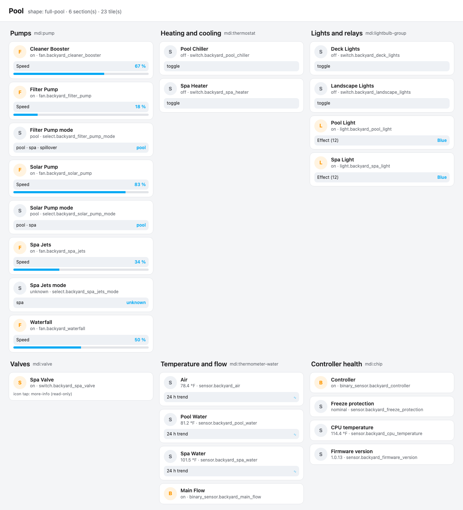

The **Control Freak Automated Pool System** integration connects Home Assistant to a
Control Freak automation controller on your local network. You can run your pumps, heaters,
chillers, lights and other relays from Home Assistant, and see water and air temperatures,
flow and the controller's health.

Use it to put the pool on the same dashboards and automations as the rest of your home. For
example, you can start the spa jets from a voice assistant, switch the pool light to a color
show at sunset, or get a notification when freeze protection activates.

The Control Freak controller is designed and built by Control Freak. For product information,
see the maker's website, [controlfreakpool.com](https://controlfreakpool.com).

## Supported devices

The integration works with the [Control Freak automation controller](https://controlfreakpool.com). Its outputs are
general-purpose: you decide in the Control Freak app what is connected to each port, and the
integration creates entities from that configuration, using the names you gave your equipment.
Nothing is tied to a port number.

The controller board has:

- **5 RS-485 ports** for variable-speed pumps and other serial equipment. Each configured pump
  becomes a pump entity with speed control.
- **4 low-voltage relays** (dry contact). Each one is either a general relay or, optionally, a
  heater or chiller with the controller's built-in control logic. A common setup uses one for a
  heater and one for a chiller, and the others for anything else, such as deck or landscape
  lighting.
- **8 high-voltage relays** for single-speed pumps, lights, a salt cell or other loads. Relays
  with a color light type (for example Pentair, Hayward or Jandy) become lights with effects.
- **8 valve actuator ports**. Valves are shown read-only for now, see
  [Known limitations](#known-limitations).
- **4 temperature sensor ports** (10K thermistors) for water, air or solar temperature.
- **2 flow switch ports**.
- **1 pressure sensor port**. The controller publishes the reading, but the integration
  doesn't create an entity for it yet.

Schedules, themes, tethers and freeze protection run on the controller itself and keep
working whatever Home Assistant does.

The integration has been tested against controller API version 1.0.13 with a Fairland
variable-speed pump, Pentair color lights and two thermistors. Heater and chiller relays,
valves and more than one pump follow the same API, but haven't been confirmed on a live
controller yet.

## Prerequisites

1. Set up your equipment in the Control Freak app, so that the controller knows which pump,
   light or sensor is on each port.
2. Find the controller's IP address or host name, for example in your router's list of
   connected devices. A fixed IP address (a DHCP reservation) is recommended.
3. Make sure Home Assistant can reach the controller on these ports:
   - **8000**: the controller's REST API.
   - **8080**: the controller's MQTT broker over WebSockets. The controller ships with
     anonymous access on path `/`, which is what the integration uses.

The integration doesn't use the Home Assistant MQTT integration, so an existing MQTT broker
is not affected.

## Configuration

To add the **Control Freak Automated Pool System** hub to your Home Assistant instance, use
this My button:

[](https://my.home-assistant.io/redirect/config_flow_start/?domain=controlfreak)

If the integration isn't installed yet, install it through HACS first. If the My button
doesn't work, set it up manually:

1. Go to **Settings** > **Devices & services**.
2. In the bottom right corner, select **Add integration**.
3. From the list, select **Control Freak Automated Pool System**.
4. Follow the instructions on screen.

| Parameter | Description |
|---|---|
| **Host** | The IP address or host name of the controller. For example, `controlfreak.local`. |
| **REST API port** | The port of the controller's REST API. The default is `8000`. Change it only if you changed it on the controller. |
| **MQTT WebSocket port** | The port of the controller's MQTT broker over WebSockets. The default is `8080`. |

Before it creates the entry, the integration checks that the REST API reports a healthy
Control Freak controller and that the MQTT broker accepts a connection.

## Configuration options

To change the options, go to **Settings** > **Devices & services** > **Control Freak
Automated Pool System** and select **Configure**.

| Option | Description |
|---|---|
| **Equipment discovery interval (seconds)** | How often the integration reads the controller's equipment list to add or remove entities. The default is 60 seconds, the range is 10 to 3600. Live values don't depend on it; they're pushed over MQTT. |

## Supported functionality

The integration creates one device, the controller. Each piece of equipment configured on
the controller adds the entities below.

### Pumps

- **Pump** (fan)
  - **Description**: Turns the pump on or off and sets its speed as a percentage. 1% is the
    pump's configured minimum speed and 100% is its maximum.
- **Mode** (select)
  - **Description**: Switches the pump between the modes it has enabled on the controller.
  - **Options**: Pool, spa, spillover, depending on the pump's settings.
  - **Remarks**: Only created when the pump has at least one mode enabled. The command is
    inferred from the captured speed command.
- **Speed** (sensor)
  - **Description**: The current speed as a percentage.
- **Current mode** (sensor)
  - **Description**: The mode the pump reports.

### Lights and relays

- **Light** (light)
  - **Description**: A relay with a color light on it. Turns the light on or off and sets
    the color or show through the light's effect list.
  - **Remarks**: The effects come from the light type configured on the controller (for
    example Pentair or Hayward).
- **Relay** (switch)
  - **Description**: Any other high-voltage or low-voltage relay, such as landscape
    lighting or a salt cell. It keeps the name you gave it in the Control Freak app.

### Heating and cooling

- **Heater** or **Chiller** (switch)
  - **Description**: A low-voltage relay that is configured in the Control Freak app as a
    heater (gas heater or heat pump) or a chiller. Turns it on or off; the controller's own
    control logic does the rest.
  - **Remarks**: The role comes from the relay's configuration, not from the port it's on.
    Set points stay in the Control Freak app.

### Valves

- **Valve** (switch)
  - **Description**: Shows whether the valve is active.
  - **Remarks**: Read-only. Turning it on or off raises an error.

### Temperature and flow

- **Temperature** (sensor)
  - **Description**: The thermistor's temperature in °F. Home Assistant converts it to your
    unit system.
  - **Remarks**: Unavailable when the thermistor is inactive, or after 180 seconds without
    an update.
- **Flow** (binary sensor)
  - **Description**: On when the flow sensor reports water flow.

### Controller

- **Controller** (binary sensor, connectivity)
  - **Description**: On while the controller publishes its status. Off after 300 seconds
    without one.
- **Freeze protection** (sensor)
  - **Description**: The state of the controller's freeze protection.
- **CPU temperature** (sensor, diagnostic)
  - **Description**: The temperature of the controller's processor.
- **Firmware version** (sensor, diagnostic)
  - **Description**: The controller's API version.

## Dashboard

The integration includes a dashboard strategy. It builds a dashboard from the equipment that
your controller actually has: a section for pumps, heating and cooling, lights and relays,
valves, temperature and flow, and controller health. Sections without equipment are left out. Equipment of a
type the strategy doesn't know yet appears in an **Other equipment** section. The dashboard
only uses cards that come with Home Assistant (heading and tile cards with tile features), so
you don't need to install anything else.

The strategy file is served by the integration and loaded automatically. You don't need to
add a dashboard resource.



### Create the dashboard

1. Go to **Settings** > **Dashboards**.
2. Select **Add dashboard**, then **Control Freak pool**.

   If the option isn't listed, select **New dashboard from scratch**, open it, select the
   three dots menu, then **Edit dashboard** > **Raw configuration editor**, and replace the
   content with:

   ```yaml
   strategy:
     type: custom:controlfreak
   ```

The dashboard is regenerated when equipment is added to or removed from the controller.

### Dashboard options

Add options under `strategy`:

```yaml
strategy:
  type: custom:controlfreak
  title: DASHBOARD_TITLE
  hide:
    - controller
  order:
    - sensors
    - pumps
  titles:
    pumps: PUMPS_SECTION_TITLE
```

| Option | Description |
|---|---|
| `title` | The dashboard title. The default is `Pool`. |
| `hide` | A list of equipment types to leave out. |
| `order` | A list of equipment types to show first, in this order. Types you don't list follow in the default order. |
| `titles` | A heading per equipment type, for example `pumps: Circulation`. |
| `device_id` | Only show the equipment of this controller, if you have more than one. |

The equipment types are:

| Type | Default heading | Cards |
|---|---|---|
| `pumps` | Pumps | A tile per pump with a speed control, followed by its mode select with buttons. |
| `heating` | Heating and cooling | A tile per relay configured as a heater or chiller, with a toggle. |
| `lights` | Lights and relays | A tile per light with its effects, and a tile per relay with a toggle. |
| `valves` | Valves | A tile per valve. |
| `sensors` | Temperature and flow | A tile per temperature with a trend graph, and a tile per flow sensor. |
| `controller` | Controller health | Connectivity, freeze protection, CPU temperature and firmware version. |
| `other` | Other equipment | A tile per entity the strategy doesn't recognize. |

### Add a single section to an existing dashboard

To add one block, such as the pumps, to a dashboard you already have, use the section
strategy in a sections view. Edit the dashboard, open the raw configuration editor, and add a
section to the view:

```yaml
views:
  - title: VIEW_TITLE
    type: sections
    sections:
      - strategy:
          type: custom:controlfreak
          equipment: pumps
          title: SECTION_TITLE
```

`equipment` is required and takes one of the equipment types above. `title` and
`device_id` are optional.

## Data updates

The integration works locally and doesn't use the cloud.

- **Live values** are pushed by the controller over MQTT on WebSockets. The
  integration subscribes to `controller/#` and updates entities as messages arrive.
  Thermistors publish about every two seconds and the controller status about every
  minute.
- **The equipment list** is read from the REST API every 60 seconds by default (see
  [Configuration options](#configuration-options)). New equipment adds entities, and
  removed equipment removes them, without a restart.

If the MQTT connection drops, the entities become unavailable and the integration reconnects
with a backoff of up to 60 seconds.

## Known limitations

- **Valves are read-only.** The command the Control Freak app sends to move a valve hasn't
  been captured, so the integration doesn't guess it.
- **The pump mode command is inferred.** It reuses the captured pump speed command with a
  different mode. Only the pool mode has been seen on a real controller.
- **Configuration isn't exposed.** Heater set points, schedules, themes and tethering stay
  in the Control Freak app. The integration never changes the controller's configuration.
- **Pressure isn't an entity yet.** The controller publishes its pressure sensor, but the
  integration doesn't create an entity for it.
- **Changing a relay's role** (for example from general relay to heater) moves it to the
  right dashboard section after you reload the integration or restart Home Assistant.
- The controller has no MQTT last will, so the **Controller** entity takes up to 300 seconds
  to turn off after the controller stops.

## Troubleshooting

### Can't set up the integration

#### Symptom: "Failed to connect"

The REST API didn't answer.

1. Check the host and the REST API port.
2. Open `http://CONTROLLER_HOST:8000/docs` in a browser on the same network. If the page
   doesn't load, the controller is off or unreachable.

#### Symptom: "The REST API answered, but the MQTT WebSocket broker did not"

1. Check the MQTT WebSocket port.
2. Make sure nothing between Home Assistant and the controller (a firewall or VLAN rule)
   blocks port 8080.

### Entities are unavailable

The integration lost its MQTT connection, or a sensor stopped publishing. Check the
**Controller** entity first: if it is off, the controller isn't publishing.

### Downloading diagnostics

Diagnostics help when you report an issue.

1. Go to **Settings** > **Devices & services** > **Control Freak Automated Pool System**.
2. Select the three dots menu, then **Download diagnostics**.

The file contains the equipment list and the last message per topic. The host, Wi-Fi and AWS
fields are redacted. Attach it to an
[issue](https://github.com/Jimmyneox/ha-controlfreak/issues).

## Removing the integration

This integration follows standard integration removal. No extra steps are required.

1. Go to **Settings** > **Devices & services** and select the integration card.
2. From the list of devices, select the controller.
3. Next to the entry, select the three dots menu, then **Delete**.

If you created a dashboard from the strategy, delete it under **Settings** > **Dashboards**.
To remove the files, uninstall the integration in HACS and restart Home Assistant.
